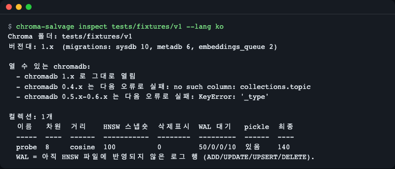
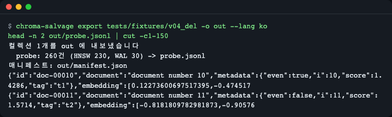
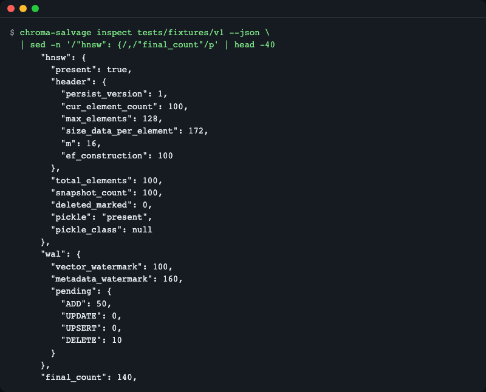
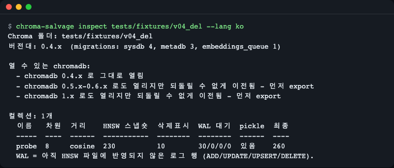
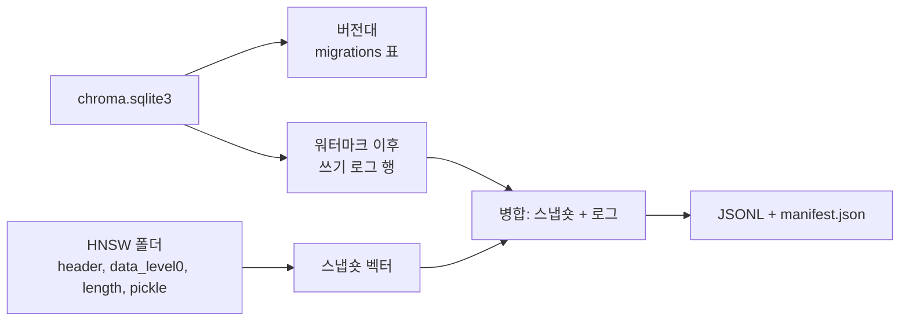

# chroma-salvage

[English](README.md) | **한국어**

Chroma 저장 폴더를 **chromadb 를 설치하지 않고** 읽습니다. 어느 버전대가 쓴 폴더인지, 어느 chromadb 버전으로 열 수 있는지 알려 주고, id·문서·메타데이터·이미 계산된 임베딩을 평범한 JSONL 로 꺼냅니다. 원본 폴더는 절대 수정하지 않으며, Python 표준 라이브러리만 씁니다.

> 비공식 도구입니다. "Chroma" 는 각 소유자의 상표이고, 이 프로젝트는 `chromadb.PersistentClient` 가 디스크에 쓴 파일을 읽기만 합니다.


*실제 Chroma 1.x 폴더에 `chroma-salvage inspect` 를 실행한 화면: 버전대, 열 수 있는 chromadb 버전, 컬렉션별 개수.*

chromadb 버전을 바꾼 뒤 이런 오류를 만났다면 이 도구가 맞습니다.

- `no such column: collections.topic`
- `KeyError: '_type'`
- 옛 폴더를 열 때 세그폴트

## 이런 분께

- 로컬 `chromadb.PersistentClient` 폴더에 RAG 색인을 쌓아 두고, 특정 chromadb 버전에 묶이지 않는 백업을 남기고 싶은 분
- chromadb 를 올리거나 내린 뒤 폴더가 안 열리는데, 옛 가상환경을 다시 만들고 덤프 스크립트를 짜지 않고 벡터를 되찾고 싶은 분
- 재임베딩 없이 다른 벡터 DB 로 옮기고 싶은 분

## 설치

Python 3.10 이상과 [uv](https://docs.astral.sh/uv/) 가 필요합니다(`curl -LsSf https://astral.sh/uv/install.sh | sh`). 샘플 폴더가 레포 안에 있으므로 clone 하려면 `git` 도 필요합니다.

```bash
git clone https://github.com/LeeGyeongPil/chroma-salvage
cd chroma-salvage
uv run chroma-salvage --version
```

출력:

```text
chroma-salvage 0.1.1
```

명령으로 설치하려면 `uv tool install git+https://github.com/LeeGyeongPil/chroma-salvage` 를 실행합니다. 이 README 의 명령은 clone 한 폴더에서 `uv run` 으로 실행해 확인했습니다.

## 빠르게 시작하기

`tests/fixtures/` 에 chromadb 0.4.24, 0.5.23, 0.6.3, 1.5.9 가 실제로 쓴 Chroma 폴더가 들어 있습니다(합성 데이터: 8차원 무작위 벡터, `document number 10` 같은 문서). 1.x 폴더로 해 보세요.

```bash
uv run chroma-salvage inspect tests/fixtures/v1 --lang ko
```

```text
Chroma 폴더: tests/fixtures/v1
버전대: 1.x  (migrations: sysdb 10, metadb 6, embeddings_queue 2)

열 수 있는 chromadb:
  - chromadb 1.x 로 그대로 열림
  - chromadb 0.4.x 는 다음 오류로 실패: no such column: collections.topic
  - chromadb 0.5.x-0.6.x 는 다음 오류로 실패: KeyError: '_type'

컬렉션: 1개
  이름   차원  거리    HNSW 스냅숏  삭제표시  WAL 대기   pickle  최종
  -----  ----  ------  -----------  --------  ---------  ------  ----
  probe  8     cosine  100          0         50/0/0/10  있음    140 
  WAL = 아직 HNSW 파일에 반영되지 않은 로그 행 (ADD/UPDATE/UPSERT/DELETE).
```

읽는 법:

- **버전대** 는 추측이 아니라 `chroma.sqlite3` 안의 `migrations` 표에서 나옵니다.
- **열 수 있는 chromadb** 는 이 폴더를 여는 chromadb 버전과, 다른 버전이 내는 정확한 오류를 보여 줍니다.
- **HNSW 스냅숏** 은 색인 파일에 든 벡터 수, **WAL 대기** 는 아직 그 파일에 반영되지 않은 쓰기 로그 행(추가/수정/upsert/삭제)입니다. **최종** 은 둘을 합친 실제 개수입니다: 100 + 50 - 10 = 140.

## 사용법

| 명령·옵션 | 하는 일 | 예 |
|---|---|---|
| `inspect PATH` | 버전대, 열 수 있는 chromadb 버전, 컬렉션별 개수를 보여 줌 | `chroma-salvage inspect ./chroma_db` |
| `inspect PATH --json` | 같은 보고서를 JSON 으로(키는 언어와 무관) | `chroma-salvage inspect ./chroma_db --json` |
| `export PATH -o OUT` | 컬렉션마다 `<컬렉션>.jsonl` 과 `manifest.json` 작성 | `chroma-salvage export ./chroma_db -o backup/` |
| `--collection NAME` | 이 컬렉션만 내보냄(여러 번 지정 가능) | `--collection docs` |
| `--normalized` | cosine 벡터를 원래 길이로 복원하지 않고 정규화된 채로 둠 | |
| `--force` | 비어 있지 않은 출력 폴더 허용 | |
| `--lang en\|ko` | 출력 언어 | `--lang ko` |

`PATH` 는 `chromadb.PersistentClient(path=...)` 에 넘긴 폴더(`chroma.sqlite3` 가 든 폴더)입니다.

### 폴더 내보내기

```bash
uv run chroma-salvage export tests/fixtures/v04_del -o out --lang ko
head -n 2 out/probe.jsonl | cut -c1-150
```

```text
컬렉션 1개를 out 에 내보냈습니다
  probe: 260건 (HNSW 230, WAL 30) -> probe.jsonl
매니페스트: out/manifest.json
{"id":"doc-00010","document":"document number 10","metadata":{"even":true,"i":10,"score":1.4286,"tag":"t1"},"embedding":[0.12273600697517395,-0.47451701760292053,0.169172003865242,0.795646071434021,-0.201199010014534,-0.5613579750061035,0.9950750470161438,0.01
{"id":"doc-00011","document":"document number 11","metadata":{"even":false,"i":11,"score":1.5714,"tag":"t2"},"embedding":[-0.8181809782981873,-0.905767023563385,-0.7807019352912903,0.254891961812973,0.5841589570045471,-0.15567998588085175,-0.8729449510574341,-0.
```


*내보내기 요약과 JSONL 첫 두 줄. 벡터 230개는 HNSW 파일에서, 30개는 쓰기 로그에서 왔습니다. 삭제 표시된 10개는 건너뜁니다.*

한 줄에 JSON 객체 하나: `id`, `document`, `metadata`, `embedding`. `manifest.json` 에는 도구 버전, 원본의 버전대와 migrations 값, 컬렉션별 차원·거리(`cosine`·`l2`·`ip`)·`normalized`·`count`·`from_hnsw`·`from_wal`·`deleted_marked`·`warnings`, 그리고 나중에 백업을 확인할 수 있도록 JSONL 파일의 `sha256` 이 담깁니다.

cosine 컬렉션은 Chroma 색인 안에 정규화된 벡터와 원래 길이(`length.bin`)를 따로 저장합니다. 내보낼 때 둘을 곱해 넣었던 벡터로 되돌립니다. 단위 벡터로 받으려면 `--normalized` 를 쓰세요. 쓰기 전 로그(WAL)에서 되살린 벡터를 포함해 출력의 모든 cosine 벡터가 길이 1이 됩니다. `manifest.json` 의 `normalized` 는 모두 단위 길이면 `true`, 하나도 아니면 `false`, `length.bin` 이 없어 색인 파일에서 읽은 벡터만 단위 길이로 남으면 `"partial"`(경고가 함께 나옵니다)입니다. `l2`·`ip` 컬렉션은 항상 `false` 입니다.

### chromadb 로 다시 넣기

아래 열 줄 남짓한 스크립트를 0.4.24 폴더에서 만든 export 로 chromadb 1.5.9 에서 실행했고 `260 records re-imported` 가 출력됐습니다. 임베딩은 JSONL 에서 오므로 재임베딩이 없습니다.

```python
import json
import chromadb

client = chromadb.PersistentClient("new_chroma")
meta = json.load(open("out/manifest.json"))["collections"][0]
col = client.get_or_create_collection(
    meta["name"], configuration={"hnsw": {"space": meta["space"]}}
)
rows = [json.loads(line) for line in open("out/" + meta["file"])]
for i in range(0, len(rows), 100):
    chunk = rows[i:i + 100]
    col.add(
        ids=[r["id"] for r in chunk],
        documents=[r["document"] for r in chunk],
        metadatas=[r["metadata"] for r in chunk],
        embeddings=[r["embedding"] for r in chunk],
    )
print(col.count(), "records re-imported")
```

다른 벡터 DB 로 옮길 때는 컬렉션을 만들 때 `manifest.json` 의 `dim`·`space` 를 맞추고 `embedding` 값을 그대로 넣으세요. `configuration=` 인자는 chromadb 1.x 방식이고, 옛 버전은 `metadata={"hnsw:space": ...}` 를 씁니다.

### 색인만 읽으면 빠지는 것 확인하기

```bash
uv run chroma-salvage inspect tests/fixtures/v1 --json
```


*스냅숏에 벡터 100개, 로그에 추가 50건과 삭제 10건이 있어 최종 140개입니다. 색인 파일만 읽으면 100개가 나옵니다.*

### 옛 폴더

```bash
uv run chroma-salvage inspect tests/fixtures/v04_del --lang ko
```


*0.4.x 폴더이고 색인에 삭제 표시된 벡터가 10개 있습니다. 더 높은 chromadb 버전은 되돌릴 수 없게 이전한다고 표시되니 먼저 export 하세요.*

## 설정

설정 파일은 없습니다. 설정은 출력 언어뿐입니다.

### 언어

다음 순서로 정해집니다.

1. `--lang en|ko`
2. 환경변수 `CHROMA_SALVAGE_LANG`
3. `LC_ALL`, `LC_MESSAGES`, `LANG`
4. 로캘이 한국어가 아니면 영어

```bash
CHROMA_SALVAGE_LANG=ko uv run chroma-salvage inspect tests/fixtures/v1
```

### 종료 코드

종료 코드: `0` 성공, `2` 입력 오류(없는 폴더, `chroma.sqlite3` 없음, `--force` 없이 비어 있지 않은 출력 폴더, 없는 컬렉션), `3` 지원하지 않거나 안전하지 않은 형식.

## 동작 원리



- `chroma.sqlite3` 의 `migrations` 표로 어느 세대의 Chroma 가 쓴 폴더인지 알 수 있습니다.
- Chroma 는 벡터를 묶음 단위로만 HNSW 색인 파일에 씁니다. 최근 추가·수정·삭제는 다음 반영 때까지 SQLite 안의 쓰기 로그에 남습니다.
- 도구는 색인 파일(헤더, 벡터 데이터, 벡터 길이)을 직접 읽고, 색인 자체의 워터마크보다 새로운 로그 행을 재생합니다.
- 문서와 메타데이터는 SQLite 표에서 읽습니다.
- 원본은 읽기 전용으로 엽니다. DB 가 WAL 저널 모드면 임시 사본을 열어 원본 폴더에 새 파일이 생기지 않게 합니다.
- `index_metadata.pickle` 은 opcode 를 허용 목록과 대조하며 걸어서 읽습니다. 실제로 unpickle 하지 않고, 무언가를 import·호출하려는 파일은 종료 코드 3 으로 거부합니다.
- 1.x 의 작은 컬렉션은 pickle 이 아예 없을 수 있습니다. 이때는 로그만으로 복원합니다.

## 검증 범위

테스트 폴더는 실제 chromadb 릴리스가 쓴 것입니다. `uv run pytest -q` 는 chromadb 를 import 하지 않고, export 결과를 정확한 입력 데이터와 chromadb 자신의 `count()` 에 견줍니다.

| 폴더 | chromadb | 확인하는 것 |
|---|---|---|
| `v04`, `v05`, `v06`, `v1` | 0.4.24, 0.5.23, 0.6.3, 1.5.9 | cosine, 버전대·개수·로그 재생 |
| `v04_l2`, `v1_l2` | 0.4.24, 1.5.9 | l2, float32 값 비트 일치 |
| `v04_del`, `v1_del` | 0.4.24, 1.5.9 | 삭제 표시 건너뛰기 |
| `v1_cfg` | 1.5.9 | configuration 으로 지정한 내적(`ip`), pickle 없음, 로그로 복원 |
| `v04_multi`, `v1_multi` | 0.4.24, 1.5.9 | 컬렉션 두 개가 섞이지 않음 |

l2·ip 값은 비트 단위로 같습니다. cosine 값은 원소별 상대오차 2e-7 이내로 같습니다(저장된 단위 벡터에 저장된 길이를 곱하는 과정). `inspect` 의 "되돌릴 수 없게 이전됨" 안내는 폴더 사본을 실제로 열어 측정했습니다: 0.4 폴더를 0.6 으로, 0.4 를 1.5 로, 1.x 를 0.4 로, 1.x 를 0.6 으로, 0.6 을 0.4 로 열어 봤습니다. 0.5.x-0.6.x 폴더를 1.x 로 여는 경우는 0.4.24 → 1.5.9 결과에서 미루어 쓴 것이며 직접 열어 보지는 않았습니다.

## 언제 쓰나 / 한계

- 잘 맞는 경우: 버전을 바꾼 뒤 열리지 않는 로컬 영속 Chroma 폴더, 또는 업그레이드 전에 백업·이전하고 싶은 폴더.
- 다루지 않는 것: Chroma 서버·Chroma Cloud 데이터, 분산 blockfile 저장소, 0.4 이전(DuckDB 형식) 폴더. 모르는 새 스키마는 `unknown-newer` 로 표시하고, 지원하지 않는 색인 파일은 잘못된 값을 쓰는 대신 종료 코드 3 으로 멈춥니다.
- 색인 파일 전체를 메모리에 읽으므로 아주 큰 컬렉션은 RAM 이 많이 필요합니다.
- 다른 방법: 지원되는 구성의 이전·백업은 공식 [Chroma 문서](https://docs.trychroma.com/)에 있습니다. 원래 chromadb 버전으로 폴더를 아직 열 수 있다면 `collection.get(include=["embeddings", "documents", "metadatas"])` 로도 꺼낼 수 있습니다.

## 자주 겪는 문제

| 증상 | 원인 | 해결 |
|---|---|---|
| `오류: 경로를 찾을 수 없습니다 ...` (종료 2) | 폴더를 잘못 지정 | `PersistentClient(path=...)` 에 넘긴 폴더를 지정 |
| `출력 폴더 ... 이(가) 비어 있지 않습니다` (종료 2) | `-o` 폴더에 파일이 있음 | 빈 폴더를 쓰거나 `--force` |
| opcode 이름과 함께 종료 3 | `index_metadata.pickle` 에 평범한 데이터 외의 것이 있음 | 그 폴더를 쓰지 말고 출처를 확인 |
| HNSW 헤더·크기 불일치로 종료 3 | 지원하지 않거나 손상된 색인 파일 | `inspect` 출력과 함께 이슈로 남기기 |
| 버전대 `unknown-newer` | 이 도구가 아는 것보다 새 스키마 | chroma-salvage 를 업데이트하거나 migrations 숫자를 알려 주기 |

## 개발·기여

```bash
uv run pytest -q
```

작성 시점에 `81 passed` 입니다. `tests/fixtures/` 폴더를 다시 만들려면 chromadb 가 필요하며 [tools/README.md](tools/README.md) 에 있습니다. 버그·제안은 이슈로 남겨 주세요. 변경 기록은 [CHANGELOG.md](CHANGELOG.md).

## 라이선스

MIT. 샘플 폴더에는 이 프로젝트용으로 만든 합성 데이터만 들어 있습니다.
