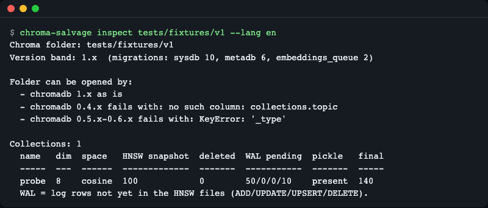
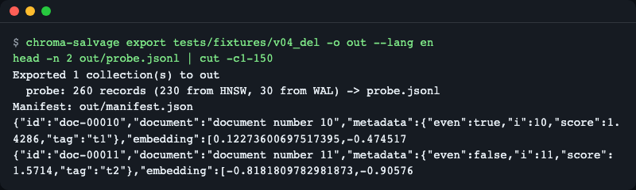
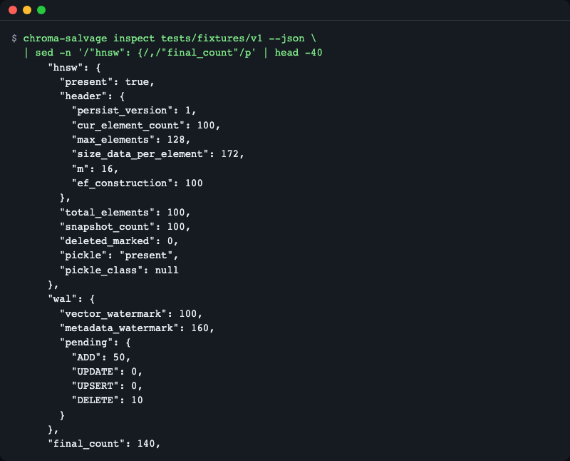
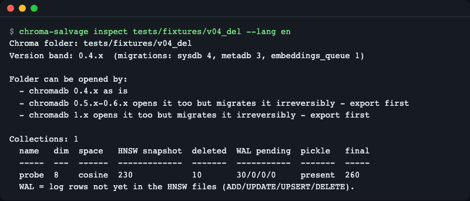
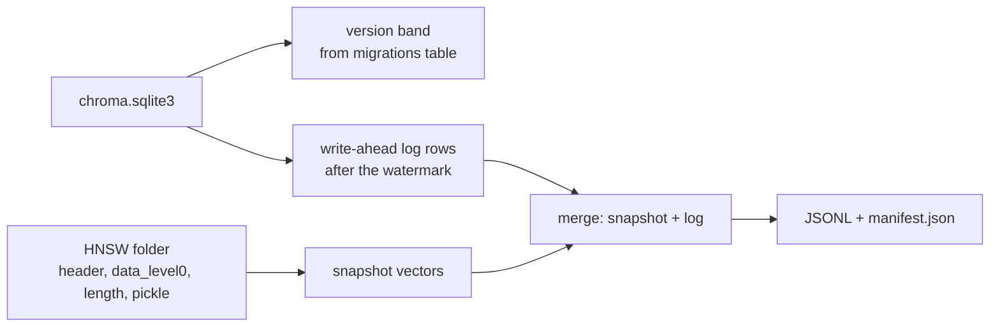

# chroma-salvage

**English** | [한국어](README.ko.md)

Read a Chroma persist folder **without installing chromadb**: find out which version band wrote it and which chromadb versions can open it, then export ids, documents, metadata and the already computed embeddings as plain JSONL. The source folder is never modified, and the tool uses only the Python standard library.

> Unofficial tool. "Chroma" is a trademark of its owners; this project only reads the on-disk files that `chromadb.PersistentClient` writes.


*`chroma-salvage inspect` on a real Chroma 1.x folder: version band, which chromadb versions can open it, and per-collection counts.*

If you landed here with one of these errors after changing the chromadb version, this is for you:

- `no such column: collections.topic`
- `KeyError: '_type'`
- a segfault when opening an old folder

## Who it is for

- You keep a RAG index in a local `chromadb.PersistentClient` folder and want a backup that does not depend on one chromadb version.
- You upgraded or downgraded chromadb and the folder no longer opens, and you want your vectors back without rebuilding an old virtualenv and writing a dump script.
- You want to move vectors to another vector database without re-embedding.

## Install

Requires Python 3.10+ and [uv](https://docs.astral.sh/uv/) (`curl -LsSf https://astral.sh/uv/install.sh | sh`). `git` is needed to clone the repository (the sample folders live in it).

```bash
git clone https://github.com/LeeGyeongPil/chroma-salvage
cd chroma-salvage
uv run chroma-salvage --version
```

Output:

```text
chroma-salvage 0.1.0
```

To install it as a command, run `uv tool install git+https://github.com/LeeGyeongPil/chroma-salvage`. The commands in this README were run from a clone with `uv run`.

## Quick start

The repository ships real Chroma folders written by chromadb 0.4.24, 0.5.23, 0.6.3 and 1.5.9 (synthetic data: 8-dimension random vectors, documents like `document number 10`) in `tests/fixtures/`. Try the 1.x one:

```bash
uv run chroma-salvage inspect tests/fixtures/v1 --lang en
```

```text
Chroma folder: tests/fixtures/v1
Version band: 1.x  (migrations: sysdb 10, metadb 6, embeddings_queue 2)

Folder can be opened by:
  - chromadb 1.x as is
  - chromadb 0.4.x fails with: no such column: collections.topic
  - chromadb 0.5.x-0.6.x fails with: KeyError: '_type'

Collections: 1
  name   dim  space   HNSW snapshot  deleted  WAL pending  pickle   final
  -----  ---  ------  -------------  -------  -----------  -------  -----
  probe  8    cosine  100            0        50/0/0/10    present  140  
  WAL = log rows not yet in the HNSW files (ADD/UPDATE/UPSERT/DELETE).
```

How to read it:

- **Version band** comes from the `migrations` table inside `chroma.sqlite3`, not from guessing.
- **Folder can be opened by** lists which chromadb versions open the folder, and the exact error the others raise.
- **HNSW snapshot** is how many vectors the index files hold. **WAL pending** is the write-ahead log rows that are not in those files yet (adds / updates / upserts / deletes). **final** is the real count after merging both: 100 + 50 - 10 = 140.

## Usage

| Command / option | What it does | Example |
|---|---|---|
| `inspect PATH` | Show the version band, openable chromadb versions and per-collection counts | `chroma-salvage inspect ./chroma_db` |
| `inspect PATH --json` | The same report as JSON (keys do not depend on language) | `chroma-salvage inspect ./chroma_db --json` |
| `export PATH -o OUT` | Write one `<collection>.jsonl` per collection plus `manifest.json` | `chroma-salvage export ./chroma_db -o backup/` |
| `--collection NAME` | Export only this collection (repeatable) | `--collection docs` |
| `--normalized` | Keep cosine vectors normalized instead of restoring their original length | |
| `--force` | Allow a non-empty output folder | |
| `--lang en\|ko` | Output language | `--lang ko` |

`PATH` is the folder you passed to `chromadb.PersistentClient(path=...)` (the one containing `chroma.sqlite3`).

### Export a folder

```bash
uv run chroma-salvage export tests/fixtures/v04_del -o out --lang en
head -n 2 out/probe.jsonl | cut -c1-150
```

```text
Exported 1 collection(s) to out
  probe: 260 records (230 from HNSW, 30 from WAL) -> probe.jsonl
Manifest: out/manifest.json
{"id":"doc-00010","document":"document number 10","metadata":{"even":true,"i":10,"score":1.4286,"tag":"t1"},"embedding":[0.12273600697517395,-0.47451701760292053,0.169172003865242,0.795646071434021,-0.201199010014534,-0.5613579750061035,0.9950750470161438,0.01
{"id":"doc-00011","document":"document number 11","metadata":{"even":false,"i":11,"score":1.5714,"tag":"t2"},"embedding":[-0.8181809782981873,-0.905767023563385,-0.7807019352912903,0.254891961812973,0.5841589570045471,-0.15567998588085175,-0.8729449510574341,-0.
```


*Export summary and the first two JSONL lines. 230 vectors came from the HNSW files and 30 from the write-ahead log. Ten more were marked deleted and are skipped.*

One JSON object per line: `id`, `document`, `metadata`, `embedding`. `manifest.json` records the tool version, the source band and migrations, and for each collection its dimension, space (`cosine`, `l2` or `ip`), `normalized`, `count`, `from_hnsw`, `from_wal`, `deleted_marked`, any `warnings`, and the `sha256` of the JSONL file so you can check the backup later.

Cosine collections store normalized vectors inside Chroma's index plus the original vector length in `length.bin`. The export multiplies them back, so you get the vectors you added. Use `--normalized` to keep unit vectors: every cosine vector in the output, including those replayed from the write-ahead log, is scaled to length 1. `manifest.json` `normalized` is `true` when all vectors are unit length, `false` when none are, and `"partial"` when `length.bin` is missing and only the vectors read from the index file stay unit length (a warning says so). `l2` and `ip` collections are always `false`.

### Re-import into chromadb

This ten-line script was run against chromadb 1.5.9 with an export made from a 0.4.24 folder; it printed `260 records re-imported`. No re-embedding happens because the embeddings come from the JSONL:

```python
import json
import chromadb

client = chromadb.PersistentClient("new_chroma")
meta = json.load(open("out/manifest.json"))["collections"][0]
col = client.get_or_create_collection(
    meta["name"], configuration={"hnsw": {"space": meta["space"]}}
)
rows = [json.loads(line) for line in open("out/" + meta["file"])]
for i in range(0, len(rows), 100):
    chunk = rows[i:i + 100]
    col.add(
        ids=[r["id"] for r in chunk],
        documents=[r["document"] for r in chunk],
        metadatas=[r["metadata"] for r in chunk],
        embeddings=[r["embedding"] for r in chunk],
    )
print(col.count(), "records re-imported")
```

For another vector database, match `manifest.json` `dim` and `space` when you create the collection, then insert the `embedding` values as they are. The `configuration=` argument is the chromadb 1.x form; older versions use `metadata={"hnsw:space": ...}`.

### See what a plain HNSW read would miss

```bash
uv run chroma-salvage inspect tests/fixtures/v1 --json
```


*The snapshot holds 100 vectors, the log holds 50 adds and 10 deletes, and the final count is 140. Reading only the index files would give 100.*

### Older folders

```bash
uv run chroma-salvage inspect tests/fixtures/v04_del --lang en
```


*A 0.4.x folder, with 10 vectors marked deleted in the index. Newer chromadb versions are reported as migrating it irreversibly, so export first.*

## Settings

There are no config files. The only setting is the output language.

### Language

Chosen in this order:

1. `--lang en|ko`
2. environment variable `CHROMA_SALVAGE_LANG`
3. `LC_ALL`, `LC_MESSAGES`, `LANG`
4. English, unless the locale is Korean

```bash
CHROMA_SALVAGE_LANG=ko uv run chroma-salvage inspect tests/fixtures/v1
```

The Korean screenshots are in [README.ko.md](README.ko.md).

### Exit codes

Exit codes: `0` ok, `2` bad input (missing folder, no `chroma.sqlite3`, non-empty output folder without `--force`, unknown collection), `3` unsupported or unsafe format.

## How it works



- The `migrations` table in `chroma.sqlite3` tells which generation of Chroma wrote the folder.
- Chroma writes vectors to HNSW index files only in batches. Recent adds, updates and deletes stay in a write-ahead log inside SQLite until the next flush.
- The tool reads the index files directly (header, vector data, vector lengths), then replays the log rows newer than the index's own watermark.
- Documents and metadata are read from the SQLite tables.
- The source is opened read-only. If the database uses WAL journal mode, the tool opens a temporary copy so the original folder gets no new files.
- `index_metadata.pickle` is read by walking its opcodes against an allow-list. It is never unpickled, and a file that tries to import or call anything is rejected with exit code 3.
- Small collections in 1.x may have no pickle at all. They are rebuilt from the log alone.

## Verified against

Test folders were written by real chromadb releases. `uv run pytest -q` compares the export against the exact input data and chromadb's own `count()`, without importing chromadb.

| Folders | chromadb | What is checked |
|---|---|---|
| `v04`, `v05`, `v06`, `v1` | 0.4.24, 0.5.23, 0.6.3, 1.5.9 | cosine; band, counts, log replay |
| `v04_l2`, `v1_l2` | 0.4.24, 1.5.9 | l2; float32 values bit-identical |
| `v04_del`, `v1_del` | 0.4.24, 1.5.9 | deleted marks skipped |
| `v1_cfg` | 1.5.9 | inner product (`ip`) set via configuration; no pickle, rebuilt from log |
| `v04_multi`, `v1_multi` | 0.4.24, 1.5.9 | two collections do not mix |

l2 and ip values match bit for bit. Cosine values match within a relative error of 2e-7 per element (each stored unit vector is multiplied by its stored length). The "migrates irreversibly" notes in `inspect` were measured by opening copies of folders: 0.4 with 0.6, 0.4 with 1.5, 1.x with 0.4, 1.x with 0.6, and 0.6 with 0.4. A 0.5.x-0.6.x folder opened by 1.x is extrapolated from the 0.4.24 to 1.5.9 result and was not opened directly.

## When to use it / Limits

- Good fit: a local persistent Chroma folder that will not open after a version change, or one you want to back up or move before upgrading.
- Not covered: Chroma server or Chroma Cloud data, distributed blockfile storage, and folders from before 0.4 (DuckDB format). A newer, unknown schema is reported as `unknown-newer` and unsupported index files stop with exit code 3 instead of writing wrong values.
- Whole index files are read into memory, so very large collections need a lot of RAM.
- Other options: the official [Chroma docs](https://docs.trychroma.com/) describe migration and backup for supported setups. If you can still open the folder with its original chromadb version, `collection.get(include=["embeddings", "documents", "metadatas"])` also works.

## Troubleshooting

| Symptom | Cause | Fix |
|---|---|---|
| `error: Path not found ...` (exit 2) | Wrong folder | Pass the folder you gave to `PersistentClient(path=...)` |
| `Output folder ... is not empty` (exit 2) | `-o` points to a folder with files | Use an empty folder or add `--force` |
| exit 3 with an opcode name | `index_metadata.pickle` contains something other than plain data | Do not use that folder. Check where it came from |
| exit 3 for HNSW header or size mismatch | Unsupported or damaged index files | Open an issue with the output of `inspect` |
| Version band `unknown-newer` | Schema is newer than this tool knows | Update chroma-salvage or report the migrations numbers |

## Development

```bash
uv run pytest -q
```

`81 passed` at the time of writing. Regenerating the folders in `tests/fixtures/` needs chromadb and is described in [tools/README.md](tools/README.md). Bugs and suggestions are welcome as issues. Changes are listed in [CHANGELOG.md](CHANGELOG.md).

## License

MIT. Sample folders contain only synthetic data generated for this project.
